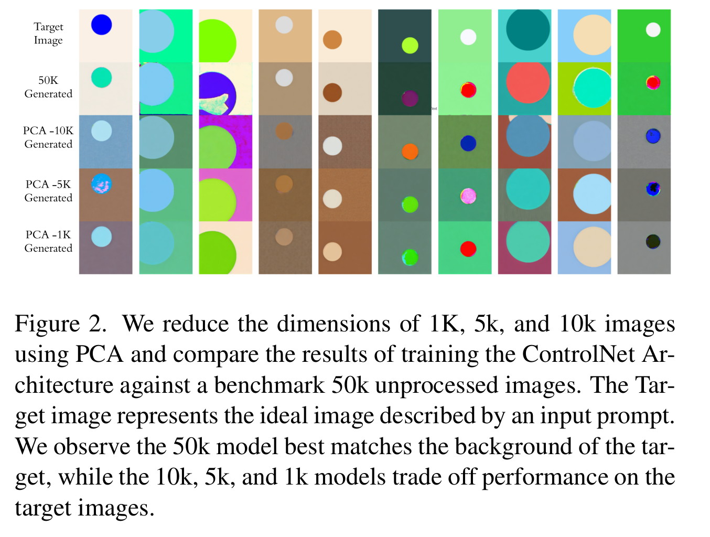
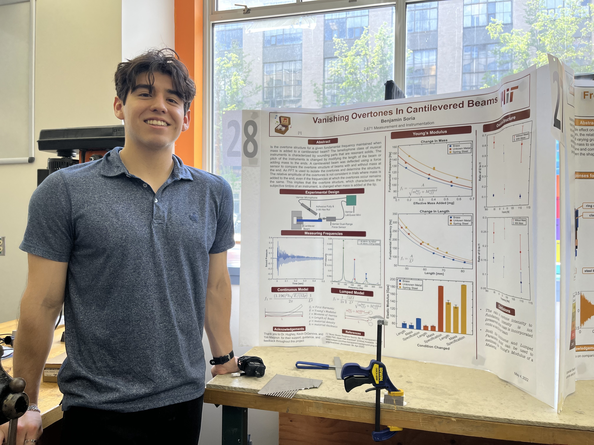
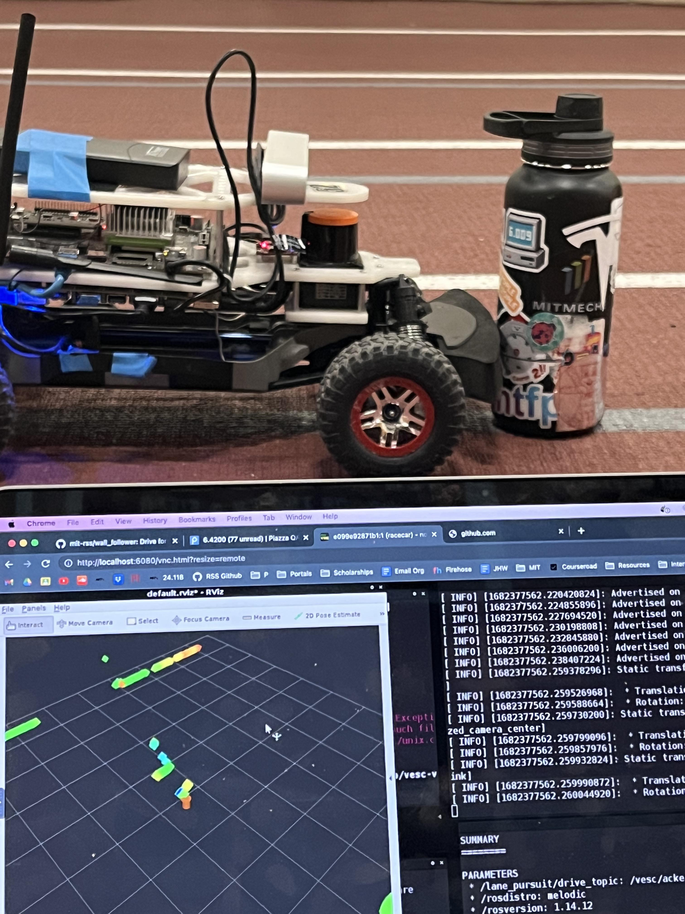
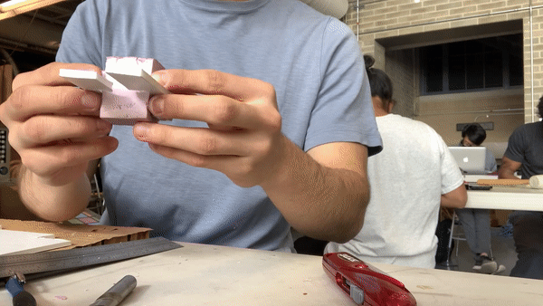
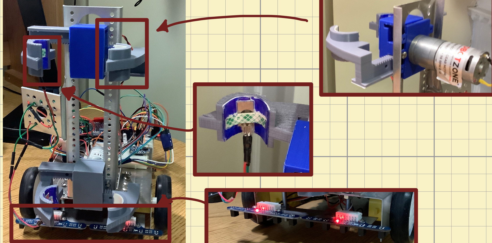
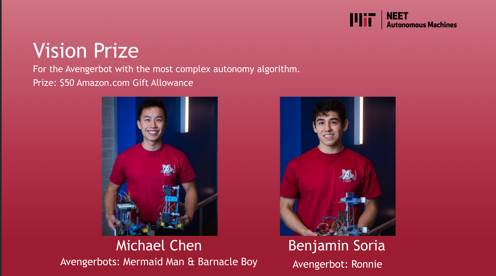

# Benjamin Soria

**MIT · Electrical Engineering & Computer Science, Minor in Mechanical Engineering**
Robotics · Reinforcement learning · Computer vision · Control

[LinkedIn](https://www.linkedin.com/in/benjamin-soria00/) · [Email](mailto:bsoria@mit.edu) · [Portfolio](https://sites.google.com/view/benjamin-soria-portfolio)

---

## Research interests

I work where learning meets physical systems: training robot policies with deep reinforcement learning and video-language models, using generative vision models in new ways, and building the estimation and control stack that gets autonomous machines working on real hardware.

## Research

**Deep reinforcement learning and video-language models** · *Summer 2024 – present (ongoing)*
Ongoing research on using video-language models in deep RL for robotics.
[Slides](https://docs.google.com/presentation/d/1PcGnZs7cBbBgM2xcaqhd-opRR_Ej_htDUWg2Nid_b9E/present)

**Modifying datasets for ControlNets using PCA** · *Spring 2024 · MIT 6.8300 Advances in Computer Vision (graduate)*
Can a smaller, PCA-compressed dataset stand in for a large one? I reduced 1K, 5K and 10K training images with PCA and compared the ControlNets trained on them against one trained on 50K unprocessed images.

[Paper](https://drive.google.com/file/d/11PAfIZcyWfGXPvs0CNtR1yieKoD7xLlo/view)

**Changing overtone structures in resonant tines** · *Spring 2023 · MIT 2.671 Measurement and Instrumentation*
A self-directed experiment on how the overtones of cantilevered beams change, the mechanism behind a music box. It draws on beam mechanics, signal processing and system identification.

[Paper](https://drive.google.com/file/d/1H6mNzmHgJiSnjtJkQ5x8ARjcKSUgyHM0/view) · [Poster](https://drive.google.com/file/d/1szAn6hTcRMyv1q6dCzS876WClwHISurg/view)

## Selected projects

**Autonomous racecar** · *Spring 2023 · MIT 6.4200 Robotics: Science and Systems*

A full autonomy stack in ROS on a 1/10-scale racecar, built across a term of labs:
- **Wall following and safety controller.** The team submitted my wall-following controller. I tuned it from step-response data (overshoot, settling time, steady-state error) recorded in rosbags and analyzed in MATLAB. [Briefing](https://docs.google.com/presentation/d/1sivVYw1Fkf11zybSDDKCwRJsJLXPqc7idBO0CB4Evdg/present)
- **Visual servoing.** Cone detection with color segmentation, SIFT and template matching, and homography to map pixels onto the ground plane. I wrote the pure-pursuit parking controller (bicycle model), which the team then reused to follow lines. [Briefing](https://docs.google.com/presentation/d/18cQlIIh_iuDbaxRWWokmokcoD_mIci4U-fR9mZMOGMY/present)
- **Monte Carlo localization.** A particle filter that uses an odometry motion model and a lidar sensor model against a known map. [Briefing](https://docs.google.com/presentation/d/11ufxx36E1ZSgfwpsBrjirrmDDNXp4Mqfip9wWvNzGA8/present)
- **Path planning.** Sampling-based planning on an occupancy grid, with pure-pursuit trajectory tracking, running in real time on the car. [Briefing](https://docs.google.com/presentation/d/1C7b9VpxYHhRhjXq_dVawzV5RwoHdwldwl2RFPdfMnl8/present)
- **Final challenge.** A 200 m lane-keeping race plus a mini-city run with stop signs. The team was recognized for combining several HSV masks so road detection held up under any lighting. [Briefing](https://docs.google.com/presentation/d/1r2gFwLRc3xfAetviI-AXy2fbz5Os1iJwkkkNg9rWM4I/present)

`ROS` `Python` `MATLAB` `probabilistic robotics` `control`

**Multi-stop package delivery for an autonomous mobile robot** · *Summer 2022 · Lockheed Martin internship*
Before this, the AMR could only carry packages headed to one destination per trip. I interviewed its users, then built a Raspberry Pi system that tracks packages by barcode scan. A "virtual queue" sends the robot on to its next stop once a location's packages have been scanned out. Routes go by priority, and a package's priority rises the longer it rides, so high-priority items arrive first.

`Raspberry Pi` `Python` `route planning`

**Ronnie, a fully autonomous competition robot** · *Spring 2022 · MIT 2.S007 Design and Manufacturing I (NEET Autonomous Machines)* · 🏆 **Vision Prize** (most complex autonomy algorithm)

  
  
  

The competition didn't require autonomy, but I built a fully autonomous robot anyway. It follows lines with PID on dual light sensors (recalibrated whenever the lighting changes), estimates position from wheel encoders and an IMU, and grips with a 3D-printed rack-and-pinion gripper that stops closing when its force sensors detect a firm grasp.

`embedded` `PID` `CAD` `3D printing`

**Optimizing the squat** · *Spring 2022 · MIT 2.086 Numerical Computation for Mechanical Engineers* (with Mark Moser)
A MATLAB model of squat biomechanics, with muscles treated as springs, that searches knee width, heel height and bar position for the setup that maximizes load or minimizes joint stress.

`MATLAB` `numerical optimization`

## Coursework (selected)

| Area | Courses |
|---|---|
| Robotics and autonomy | 6.8300 Advances in Computer Vision (G) · 16.4130 Principles of Autonomy and Decision Making (G) · 16.84 Advanced Autonomous Robotic Systems (capstone) · 6.141 Robotics: Science and Systems |
| Math and inference | 6.7810 Algorithms for Inference (G) · 18.06 Linear Algebra · 18.600 Probability · 6.1200 Mathematics for Computer Science |
| Control and dynamics | 2.14 Analysis and Design of Feedback Control (G) · 2.004 Dynamics and Control II · 6.2000 Electric Circuit Modeling |
| Computer science | 6.3900 Introduction to Machine Learning · 6.1210 Introduction to Algorithms · 6.1020 Elements of Software Construction |

## Outreach

- Assistant instructor, MIT Global Teaching Labs: Robotics and 3D Design. Barcelona, January 2022
- Engineering design TA, MITES Saturdays. Cambridge, MA, fall 2022
- Project mentor, Women's Technology Program. Cambridge, MA, July 2022
- Online facilitator, MITES Semester, 2021–22
- Member, MIT Camp Kesem
